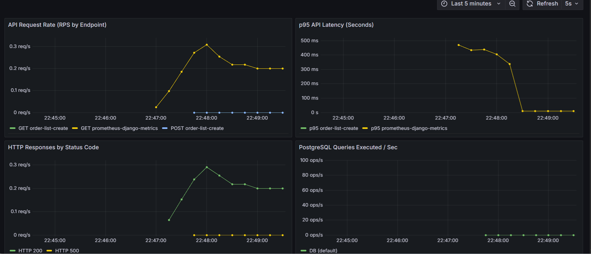

# OrderPulse — Event-Driven Order & Webhook Fulfillment Engine

A production-patterned microservice demonstrating **end-to-end backend engineering**: REST API design, ACID relational modeling, NoSQL audit logging, asynchronous event-driven retries, SQL query tuning, and automated GitHub Actions CI.

---

## Architecture & 5-Step Data Flow

```text
[Client] ──POST /api/orders──▶ [Django REST API]
                                      │
                        1. ACID Write │ 2. transaction.on_commit()
                                      ▼
                              [PostgreSQL 16] ──▶ [Redis Broker]
                                                        │
                                                        ▼ 3. Async Consume
                                                 [Celery Worker]
                                                   │         │
                               4. HTTP + Retries   │         │ 5. Raw Audit Log
                                                   ▼         ▼
                                         [3rd-Party API]  [MongoDB 7]
```

1. **API Ingestion (`Django REST Framework`):** Validates incoming order payloads via a thin view layer delegating to `orders/services.py`.
2. **Transactional Persistence (`PostgreSQL`):** Writes `Order` and `OrderItem` records atomically and queues the background event **only after commit** (`transaction.on_commit`).
3. **Asynchronous Fulfillment (`Celery + Redis`):** Decouples external network I/O from user request latency, retrying transient upstream failures with exponential backoff.
4. **Schema-Less Audit Logging (`MongoDB`):** Captures raw, variable third-party webhook responses and latency metrics without relational schema migrations.
5. **Polyglot Read & Query Tuning:** `GET /api/orders/` uses `prefetch_related` (enforced by a 2-query CI budget), while `GET /api/orders/<uuid>/` merges relational order state with its MongoDB webhook audit trail.

---

## Quickstart (Run Locally in 60 Seconds)

### Prerequisites
* Docker & Docker Compose

### 1. Boot the Full Stack
```bash
cp .env.example .env 2>/dev/null || true
docker compose up -d --build
```

### 2. Run Database Migrations & Integration Tests
```bash
docker compose exec web python manage.py migrate
docker compose exec web pytest -v
```

---

## API Usage Examples

### Create an Order (`POST /api/orders/`)
```bash
curl -s -X POST http://localhost:8000/api/orders/ \
  -H "Content-Type: application/json" \
  -d '{
    "customer_email": "builder@garage.dev",
    "items": [
      {"sku": "OAK-TABLE-01", "quantity": 1, "unit_price_cents": 32000},
      {"sku": "OAK-CHAIR-04", "quantity": 4, "unit_price_cents": 8500}
    ]
  }' | python3 -m json.tool
```

### Inspect Order + MongoDB Webhook Audit (`GET /api/orders/<id>/`)
```bash
curl -s http://localhost:8000/api/orders/<ORDER_UUID>/ | python3 -m json.tool
```

### List Orders (`GET /api/orders/`)
```bash
curl -s http://localhost:8000/api/orders/ | python3 -m json.tool
```

---

## Engineering Highlights & Documentation

* **CI/CD Pipeline (`.github/workflows/ci.yml`):** Spins up live PostgreSQL, MongoDB, and Redis service containers on every push to run `ruff` linting, `pytest` end-to-end tests, and Docker build verification.
* **Query Optimization Proof:** `test_list_orders_prevents_n_plus_one` enforces constant query counts (`O(1)` queries regardless of order volume).
* **Technical Tradeoffs (`docs/TRADEOFFS.md`):** Plain-English and architectural comparisons written for both engineering teams and non-technical stakeholders.

---

## Live Observability (Prometheus & Grafana)


